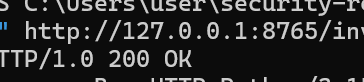
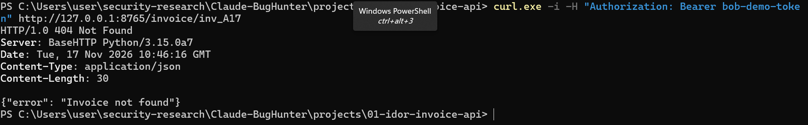

# PaperNest — IDOR / BOLA Security Lab

A practical Python security lab demonstrating Insecure Direct Object Reference (IDOR), also known as Broken Object Level Authorization (BOLA), through vulnerable and secure API implementations.

## Project Overview

PaperNest is a deliberately vulnerable, localhost-only invoice API built to demonstrate how missing authorization checks can expose another user's private information.

The lab uses two fictional users, Alice and Bob, and compares two application modes:

- **Vulnerable mode:** Authenticated users can access invoices belonging to other users.
- **Secure mode:** The application verifies invoice ownership before returning invoice data.

The application runs on `127.0.0.1:8765` and uses fictional data only.

## Learning Objectives

- Understand authentication versus authorization.
- Understand IDOR and BOLA vulnerabilities.
- Test object-level access controls using two accounts.
- Inspect HTTP requests and responses.
- Identify missing server-side ownership checks.
- Implement and verify an authorization fix.
- Produce reproducible security evidence and reports.

## Technology Stack

| Component | Technology |
|---|---|
| Operating system | Windows 11 |
| Programming language | Python |
| HTTP server | Python `http.server` |
| Testing tool | `curl.exe` |
| Network scope | Localhost only |
| Port | 8765 |

## Lab Architecture

The application contains:

- Alice's fictional account and invoice.
- Bob's fictional account and invoice.
- Bearer-token authentication.
- An invoice API endpoint.
- A vulnerable authorization implementation.
- A secure ownership-check implementation.

### Fictional Test Accounts

| User | Demo token | Own invoice |
|---|---|---|
| Alice | `alice-demo-token` | `inv_A17` |
| Bob | `bob-demo-token` | `inv_B29` |

These tokens are for this local educational lab only.

## Installation and Execution

Ensure Python is installed.

Open PowerShell in the project directory.

### 1. Start vulnerable mode

```powershell
py .\papernest.py vulnerable
```

### 2. Start secure mode

Stop the previous server with `Ctrl+C`, then run:

```powershell
py .\papernest.py secure
```

The server listens at:

`http://127.0.0.1:8765`

## Vulnerability Reproduction

### Test: Bob attempts to access Alice's invoice

Run this command while either application mode is running:

```powershell
curl.exe -i -H "Authorization: Bearer bob-demo-token" http://127.0.0.1:8765/invoice/inv_A17
```

### Vulnerable mode — Expected result

```http
HTTP/1.0 200 OK
```

The server returns Alice's invoice to Bob.

**Security impact:** An authenticated user can access another user's invoice because the application does not enforce object ownership.

[View vulnerable response evidence](evidence/vulnerable-response.txt)



### Secure mode — Expected result

```http
HTTP/1.0 404 Not Found
```

The server refuses to return Alice's invoice to Bob.

**Security improvement:** The application verifies that the authenticated user owns the requested invoice.

[View secure response evidence](evidence/secure-response.txt)



## Root Cause Analysis

The vulnerable implementation authenticates the user but fails to verify authorization for the requested invoice.

Authentication answers:

**Who are you?**

Authorization answers:

**Are you allowed to access this resource?**

The vulnerability occurs because authentication is implemented without the required object-level ownership check.

## Remediation

The secure implementation checks ownership before returning invoice information:

```python
if MODE == "secure" and invoice["owner"] != current_user:
    return self.send_json(404, {"error": "Invoice not found"})
```

Production applications should enforce object-level authorization on every request that accesses or modifies a protected resource.

Additional security recommendations:

- Derive the authenticated identity from a securely validated session or token.
- Check ownership or permissions on the server.
- Apply authorization checks to read, update, and delete operations.
- Avoid relying on hidden IDs or unpredictable identifiers as security controls.
- Add automated tests for cross-user access attempts.

## Evidence Directory

```text
evidence/
├── vulnerable-response.txt
├── secure-response.txt
├── idor-vulnerable.png
└── idor-secure.png
```

## Skills Demonstrated

- Python programming
- HTTP request and response analysis
- REST API security
- Authentication and authorization
- IDOR / BOLA vulnerability testing
- Access-control validation
- Vulnerability documentation
- Secure coding principles
- Git and GitHub portfolio management

## Limitations

This is a deliberately simplified educational application. It is not a production authentication system and does not represent a complete assessment of a real-world API.

The results demonstrate the behavior of this local application only.

## Safety and Authorization

This project uses fictional users, fictional invoices, and a local-only server bound to `127.0.0.1`.

No external systems or real user data are involved.

Only test systems for which you have explicit authorization.

## Author

**BrianSecLabs**

Cybersecurity learner | API Security | Vulnerability Research

GitHub: [brian455-art](https://github.com/brian455-art)